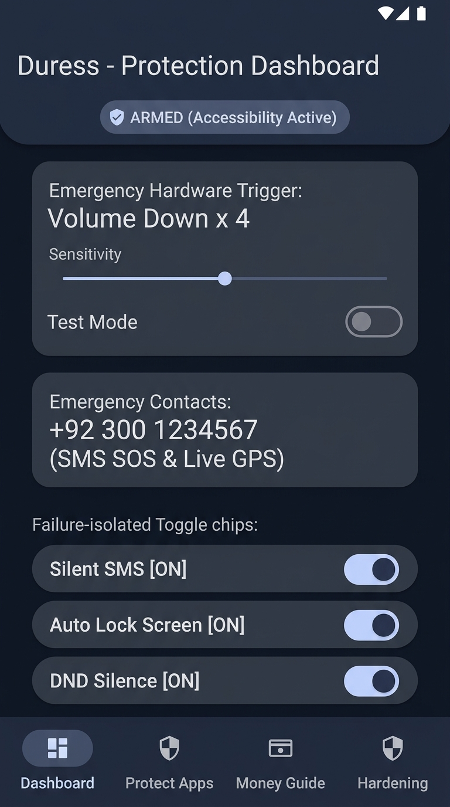
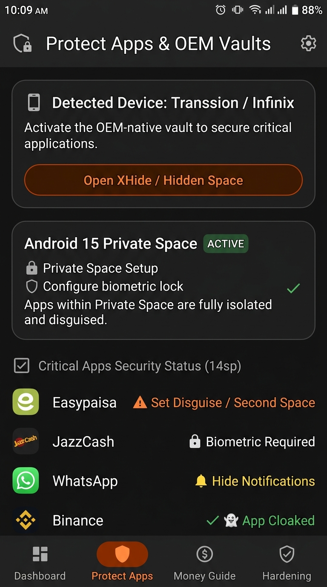
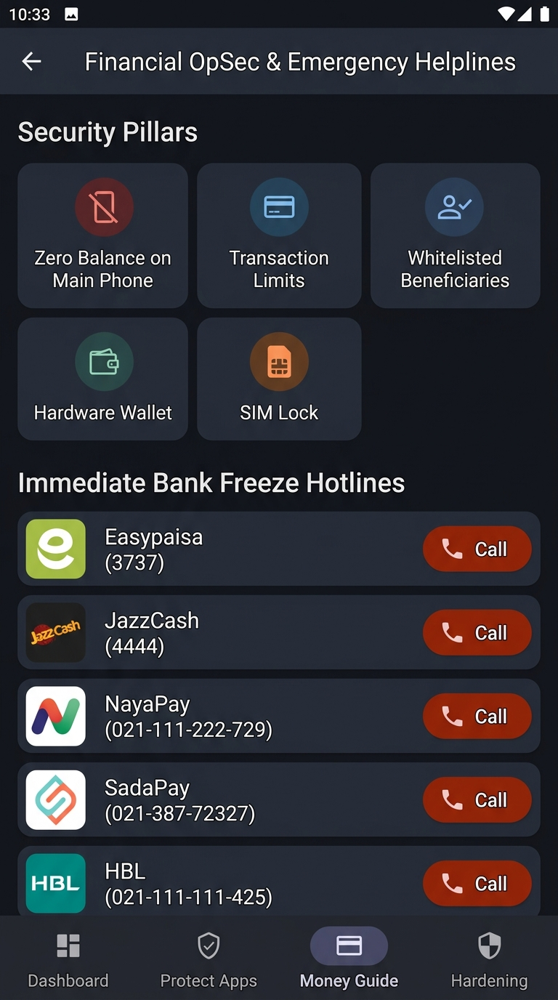

# Duress (ضرر / اضطرار) 🛡️

**An Offline Personal-Safety & Anti-Coercion Android App for High-Risk Situations**

[](https://kotlinlang.org/)
[](https://developer.android.com/jetpack/compose)
[-brightgreen?style=for-the-badge)](https://developer.android.com/)
[-blue?style=for-the-badge)](https://developer.android.com/)
[-success?style=for-the-badge)](https://developer.android.com/)
[](LICENSE)

---

## 📌 Overview

**Duress** is an open-source, zero-network, personal-safety application designed specifically for high-risk coercion scenarios (such as street snatching or forced device unlock) on budget Android devices common in Pakistan (Infinix, Tecno, Xiaomi/Redmi, Vivo, Oppo, Samsung Galaxy A-series, Android 8 to 15).

When forced to unlock your phone at gunpoint or under physical duress:
1. Entering a **Duress PIN** unlocks a realistic decoy environment (Notes app or Storage Cleaner) while silently dispatching an SOS in the background.
2. Clicking a **hardware key sequence** (e.g. Volume Down $\times 4$) triggers a silent emergency pipeline without unlocking or touching the screen.
3. Your emergency contacts receive periodic **silent SMS updates with real-time Google Maps coordinates** while your device locks, silences incoming calls, and clears sensitive logs.

> [!IMPORTANT]
> **Strict Zero-Network Guarantee**: Duress contains **ZERO** `android.permission.INTERNET`. There is no telemetry, no tracking, no cloud servers, and no external dependencies. All data is processed on-device and protected by hardware-backed Android KeyStore encryption.

---

## 📸 App Screenshots

<p align="center">
  
  &nbsp;&nbsp;&nbsp;&nbsp;
  
  &nbsp;&nbsp;&nbsp;&nbsp;
  
</p>

---

## ✨ Key Features

### 1. Covert Hardware & System Triggers
- **Accessibility Key Sequence**: Detects hardware key patterns (default: `Volume Down x 4` within 3 seconds) even when the screen is locked or turned off.
- **Pre-SOS Abort Grace Period**: Provides a subtle double-haptic vibration upon trigger detection. Pressing the opposite volume button within 3–5 seconds aborts the SOS dispatch to prevent accidental triggers.
- **Quick Settings (QS) Tile & Launcher Widget**: One-tap trigger options for rapid activation.
- **Stealth Launcher Camouflage**: Dynamic launcher alias disguising Duress as a standard utility ("Calculator" or "Clean Notes").

### 2. Silent Emergency SOS Pipeline
- **Silent SMS Dispatch**: Sends immediate emergency text alerts to configured trusted contacts with real-time GPS coordinates.
- **Live Location Tracking**: Continuously refreshes GPS coordinates and sends automated location updates every 60 seconds for 15 minutes.
- **Instant Device Lock**: Instant screen lock using `GLOBAL_ACTION_LOCK_SCREEN` (Android 9+) or `DevicePolicyManager.lockNow()` device administration fallback (Android 8).
- **DND Silence**: Suppresses audible alerts, vibrations, and notifications during emergency situations.
- **Zero-SMS Test Mode**: Allows safely testing the trigger, lock screen, and haptics without sending real SMS alerts to contacts.

### 3. Dual PIN & Decoy System
- **Real PIN vs. Duress PIN**:
  - **Real PIN**: Opens the full configuration dashboard, logs, and sensitive settings.
  - **Duress PIN**: Opens an innocuous decoy app (Notes or Storage Cleaner) while simultaneously and silently triggering the background SOS pipeline.
- **Hardware-Backed Encryption**: Master keys and preferences are secured via Android KeyStore using `AES-256-GCM`.

### 4. App Vault & Cloaking Guides
- **OEM Vault Deep Links & Manual Guides**:
  - **Transsion (Infinix / Tecno)**: XHide & Phone Master integration.
  - **Xiaomi / Redmi / Poco**: Second Space & App Lock.
  - **Samsung**: Secure Folder & Dual Messenger.
  - **Vivo / Oppo / Realme**: App Encryption & Privacy Safe.
  - **Android 15+**: Native Private Space.
  - **Universal Fallback**: Island / Shelter Work Profile sandboxing.
- **10-App OpSec Checklist**: Guidance for securing Easypaisa, JazzCash, banking apps, WhatsApp, crypto wallets, and gallery vaults.

### 5. Pakistan Financial OpSec Guide
- **5 Security Pillars**: Balance limits, strict beneficiary whitelisting, time-delayed transfers, cold storage hardware wallets, and SIM PIN locks.
- **One-Tap Emergency Freeze Directory**: Direct dialers for 12 Pakistani banking and fintech hotlines (Easypaisa `3737`, JazzCash `4444`, NayaPay, SadaPay, HBL, Meezan Bank, Alfalah, UBL, MCB, Faysal, Allied, Standard Chartered).
- **Remote Lock & SIM Invalidation**: Step-by-step guides for PTA DIRBS IMEI blocking and SIM deactivation.

### 6. Device Hardening & Keep-Alive
- **Doze Whitelist Exemption**: Requests `ACTION_REQUEST_IGNORE_BATTERY_OPTIMIZATIONS` so background triggers are never suspended in deep sleep.
- **Per-Brand Keep-Alive Wizard**: Auto-detects device OEM and guides users through aggressive battery killers (Infinix Phone Master, Xiaomi HyperOS autostart, Vivo iManager, Oppo Safecenter).
- **Privacy Screen (`FLAG_SECURE`)**: Masks app contents from screenshot capture and recents/multitasking preview.
- **Camouflage Display**: One-tap full-screen black screen or fake system update screen disguise.

---

## 🌐 Localization (English + اردو)

Duress is fully localized in **English** and **Urdu (اردو)** with native Right-to-Left (RTL) layout support, ensuring accessibility for non-English speakers across Pakistan.

---

## 🛠️ Architecture & Tech Stack

```
com.duress.app
├── data/           # DuressPreferences (DataStore), SecurityManager (KeyStore AES-256)
├── decoy/          # DecoyActivity, DecoyNotesView, DecoyCleanerView
├── hardening/      # BatteryOptimizationHelper, KeepAliveWizardHelper
├── money/          # MoneyGuideModels, Pakistani Bank Helplines Directory
├── protection/     # AppProtectionHelper, OEM Vault Intents & Checklist
├── receiver/       # BootReceiver (Re-arms safety watchers on device restart)
├── service/        # DuressAccessibilityService (Volume key detector & SOS coordinator)
└── ui/             # Jetpack Compose M3 UI (HomeScreen, HardeningScreen, DecoyScreen)
```

- **UI**: Jetpack Compose M3, Material You Dynamic Color
- **State**: StateFlow, ViewModel, Failure-isolated coroutine scopes
- **Security**: Android KeyStore (`AndroidKeyStore`, `AES/GCM/NoPadding`)
- **Persistence**: Jetpack DataStore Preferences
- **Build**: Kotlin DSL Gradle, Single module architecture

---

## 🚀 Building & Sideloading

### Prerequisites
- JDK 17 or 21 (e.g. Android Studio JBR)
- Android SDK (API 26 to 35)

### Build Debug APK
```bash
# Clone the repository
git clone https://github.com/<YOUR_USERNAME>/duress-android.git
cd duress-android

# Build debug APK
./gradlew assembleDebug
```
The generated APK will be located at:
`app/build/outputs/apk/debug/app-debug.apk`

### Install via ADB
```bash
adb install app/build/outputs/apk/debug/app-debug.apk
```

---

## 🔒 Permissions & Privacy Model

Duress strictly adheres to the principle of least privilege. Every single permission is accompanied by an in-app explanation before requesting:

| Permission | Purpose |
|---|---|
| `ACCESSIBILITY_SERVICE` | Detects hardware volume button sequences while screen is off/locked. |
| `ACCESS_FINE_LOCATION` | Attaches real-time GPS coordinates to SOS distress messages. |
| `SEND_SMS` | Dispatches covert SMS alerts to designated emergency contacts. |
| `ACCESS_NOTIFICATION_POLICY` | Enables Do-Not-Disturb (DND) during emergencies to silence alerts. |
| `REQUEST_IGNORE_BATTERY_OPTIMIZATIONS` | Prevents OEM battery savers from terminating background monitoring. |
| `RECEIVE_BOOT_COMPLETED` | Restores safety monitoring upon device reboot. |
| `INTERNET` | **NOT REQUESTED**. App is 100% offline. |

---

## ⚖️ License

Distributed under the MIT License. See [LICENSE](LICENSE) for more information.
